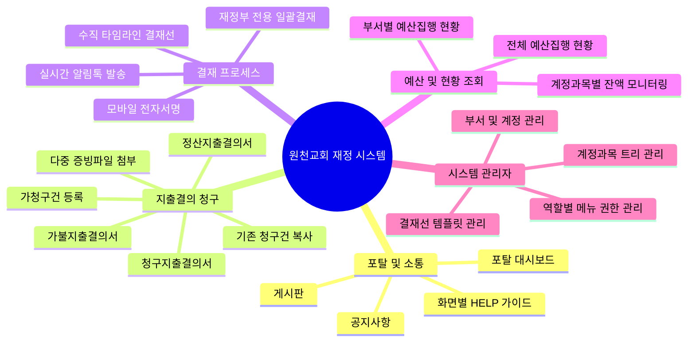
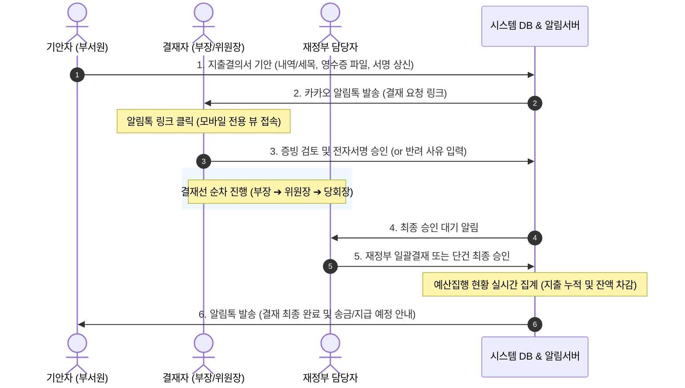

# 원천교회 재정부 지출청구 및 예산관리 시스템 소개

> **본 문서는 원천교회 재정 청구 및 예산 관리 시스템의 원활한 이용을 돕기 위해 작성된 사용자 가이드라인입니다.**  
> 각 슬라이드(Slide) 구분을 통해 발표 장표 또는 사용자 매뉴얼 형태로 가독성 있게 구성되었습니다.

---

## 🖥️ Slide 1. 시스템 개요 및 도입 배경
### **"종이 없는 재정 관리, 투명하고 신속한 결재"**

원천교회 재정부 지출청구 및 예산관리 시스템은 기존의 종이 영수증 첨부와 수기 결재 방식에서 벗어나, **모든 청구·정산·결재 및 예산 집행 현황을 온라인으로 통합 관리**하는 디지털 재정 행정 시스템입니다.

```
┌────────────────────────────────────────────────────────────────────────┐
│                        Woncheon Finance Portal                         │
│  [지출결의서 작성] ────► [역할별 온라인 결재] ────► [실시간 예산 연동]   │
│     (PC / 모바일)         (담당/부장/위원장/당회장)        (계정과목별 집행률)     │
└────────────────────────────────────────────────────────────────────────┘
```

#### **핵심 가치**
* **신속성**: 시공간 제약 없는 모바일 결재 지원 및 실시간 알림톡 연동
* **투명성**: 모든 결재 이력 및 결재자 서명 내역의 영구 보존 및 추적
* **정확성**: 부서별/계정과목별(관·항·목·세목) 예산 집행률 실시간 통제 및 초과 방지
* **편의성**: 포탈 대시보드, 화면별 HELP 가이드, 기본 서명 자동 불러오기 및 재청구 복사 기능 제공

---

## 🌟 Slide 2. 시스템 주요 특장점 (Key Advantages)

본 시스템은 사용자의 편리성과 재정 관리의 무결성을 극대화하기 위해 다음과 같은 특장점을 제공합니다.

| 구분 | 주요 특징 | 상세 설명 |
| :--- | :--- | :--- |
| **📱 완벽한 모바일 연동** | 기기별 최적화 듀얼 UI | PC 웹과 모바일 환경을 자동 감지(`isMobile`)하여 화면별 전용 UI(하단 고정 탭바, 모바일 카드 뷰, 접이식 검색필터)를 제공합니다. |
| **💬 알림톡 실시간 연동** | 지연 없는 의사소통 | 결재 요청, 반려, 최종 완료 시 카카오 알림톡이 자동으로 발송되어 업무 누수를 방지합니다. |
| **🔒 데이터 무결성 보장** | 서명 중복 방지 로직 | 인덱스(idx) 기반 서명 매칭 기술로 동일 부서/역할 내 중복 결재선 지정 시에도 서명이 왜곡되거나 꼬이지 않습니다. |
| **📊 실시간 예산 통제** | 예산 대비 집행 실시간 조회 | 기안 시 관·항·목별 예산 총액, 지출 누계, 실시간 잔액을 즉시 확인하여 예산 초과를 사전에 방지합니다. |
| **🗂️ 재정부 일괄결재** | 대량 결재 원클릭 처리 | 재정부 결재 대기 건들을 체크박스로 다중 선택하여 일괄 서명 및 일괄 승인 처리가 가능합니다. |
| **💡 화면별 HELP 가이드** | 화면 목적 및 3단계 순서 | 화면 상단 타이틀 옆 `HELP` 버튼을 클릭/호버하면 화면 용도와 사용 순서가 말풍선으로 제공됩니다. |

---

## 🛠️ Slide 3. 시스템 메뉴 및 주요 기능 구조도

원천교회 지출청구 시스템은 **포탈 / 청구 / 결재 / 예산 / 시스템 관리 / 소통** 영역으로 구성되어 있습니다.



---

## 🏠 Slide 4. [포탈 홈] 대시보드 및 공통 네비게이션

### **"한눈에 파악하는 업무 현황과 신속한 바로가기"**

로그인 후 가장 먼저 진입하는 메인 대시보드 화면(`/portal`)입니다.

#### **1. KPI 스탯 요약 바**
* **결재 대기 목록 / 결재 진행중 / 완료된 결재 / 반려 목록**의 최신 1개월 건수를 상단 카드 형태로 집계 노출합니다.
* 카드를 클릭하면 해당 목록 화면으로 즉시 이동합니다.

#### **2. 4분할 메인 패널 (2×2 그리드)**
* **청구목록 조회 패널**: 내가 기안한 최근 청구건의 상태(결재진행중, 완료, 반려) 실시간 확인
* **결재 대기 목록 패널**: 내가 승인해야 할 결재 대기 문서 및 금액 확인
* **공지사항 & 자유게시판 패널**: 재정부 공지사항(New 배지) 및 성도/부서원 간 소통 게시판 연동

#### **3. 공통 네비게이션 & 편의 기능**
* **⏱️ 자동 로그아웃 타이머**: 사이드바 하단에 세션 만료 카운트다운(1시간)이 실시간 표시되어 정보 유출을 예방합니다.
* **📱 모바일 플로팅 `MENU` 탭**: 모바일 접속 시 좌측에 드래그 가능한 `MENU` 탭이 노출되어 엄지손가락으로 손쉽게 네비게이션을 호출할 수 있습니다.
* **💡 `HELP` 버튼**: 모든 화면 타이틀 옆에서 화면의 용도, 사용 순서 3단계, 유의사항을 바로 확인할 수 있습니다.

---

## 👤 Slide 5. [역할별 가이드] 1. 기안자 (부서원/담당자)
### **"간편한 지출결의서 작성, 가청구 등록 및 청구 복사"**

부서 예산 집행을 위해 지출결의서를 작성하고 청구하는 담당자의 프로세스입니다.

```
[1. 기본정보 입력] ──► [2. 지출내역 & 예산확인] ──► [3. 증빙 첨부] ──► [4. 결재선 확인 & 서명 상신]
```

#### **상세 사용 방법**
1. **지출결의서 작성 (`/reportForm`)**:
   * **1단계 (기본정보)**: 청구 유형(**청구 / 정산 / 가불**) 선택, 영수인 및 제출일자 입력, 부서 계좌정보 확인 (계좌 변경 시 '부서정보 계좌 업데이트' 지원)
   * **2단계 (지출내역)**:
     - 관 · 항을 선택하면 부서의 **예산 총액 / 지출 누계 / 실시간 잔액**이 상단에 즉시 계산되어 표시됩니다.
     - 목 · 세목을 선택하거나 직접 입력하고, 지출 상세내역과 금액을 입력합니다. (세목은 필수 항목)
   * **3단계 (파일첨부)**: 영수증 등 증빙 서류를 업로드합니다. (개별 파일 **10MB**, 총합 **50MB** 한도, 다중 파일 업로드 지원)
   * **4단계 (최종확인 & 서명)**: 결재선을 선택(기안자 부서 결재선 vs Owner 부서 결재선)하고, 추가 의견 입력 후 **본인 전자서명**(캔버스 서명 또는 등록된 기본 서명)을 완료하여 **결재요청**을 클릭합니다.
2. **청구목록 조회 & 복사 (`/approvalList`)**:
   * 본인이 기안한 문서의 실시간 승인 진행 상태를 확인합니다.
   * **수정/삭제**: 최초 결재자가 승인하기 전(기안 단계)에 한해 언제든 수정 및 삭제가 가능합니다. (이후 단계는 무결성을 위해 수정 불가)
   * **📋 청구 복사**: 이전과 유사한 내역을 기안할 경우, 상세 열의 '복사하기' 버튼을 누르면 기존 내용이 그대로 채워진 새 작성 화면으로 이동하여 입력 시간을 대폭 단축할 수 있습니다.
3. **가청구건 등록 (`/initialExpenseInput`)**:
   * 사전 품의나 예정된 가청구 지출 내역을 사전에 등록하여 관리할 수 있습니다.

---

## ✍️ Slide 6. [역할별 가이드] 2. 결재자 (부장/위원장/당회장)
### **"모바일 지원으로 언제 어디서나 신속한 서명 승인"**

기안된 지출결의서를 검토하고 온라인으로 승인 또는 반려하는 의사결정권자 프로세스입니다.

#### **결재선 구성 및 시각화**
* **순차 결재선**: `담당(기안자) ➡️ 부장 ➡️ 위원장 ➡️ 당회장` 단계별 결재 흐름을 수직 타임라인으로 시각화합니다.
* **동적 하이라이트**: 기안자 및 이전 승인 단계는 흐리게(Dimmed, `opacity-30`) 표시되고, **현재 결재 차례인 승인자는 인디고 링(`ring-4 ring-indigo-100`)으로 강조**되어 결재 병목 지점을 즉시 알 수 있습니다.

#### **결재 처리 방법**
1. **알림톡 수신**: 결재 순서가 되면 카카오 알림톡으로 기안 부서, 기안자, 청구 금액 및 바로 결재 링크가 발송됩니다.
2. **내역 검토 (`/approvalStatus`)**: 모바일 또는 PC에서 결재 대기 문서를 열어 지출 항목, 금액, 첨부된 영수증 이미지를 면밀히 검토합니다.
3. **승인 또는 반려**:
   * **승인**: 결재 의견을 입력하고 캔버스에 서명(기본 서명이 자동 로드됨)한 뒤 **승인** 버튼을 클릭합니다. 다음 결재자에게 자동으로 알림톡이 인계됩니다.
   * **반려**: 반려 사유를 구체적으로 입력한 후 **반려** 버튼을 클릭합니다. (기안자에게 즉시 반려 알림톡이 전송되며 프로세스가 종료됩니다.)

---

## 💰 Slide 7. [역할별 가이드] 3. 재정부 담당자
### **"최종 결재, 일괄 승인 및 완벽한 예산 모니터링"**

교회 전체 재정을 최종 집행하고 예산 통제 및 계정과목을 총괄하는 재정부 사용자용 프로세스입니다.

#### **1. 재정부 기안 즉시 결재완료**
* 재정부 부서원이 직접 기안하는 문서는 별도의 복잡한 승인 절차 없이 **기안과 동시에 시스템상 즉시 승인 완료** 처리됩니다.

#### **2. 재정부 일괄결재 (`/bulkApproval`)**
* 주말이나 회계 마감 시 대량으로 유입되는 결재 건들을 개별 조회할 필요 없이 한 번에 처리합니다.
* 기간 및 부서 필터링 ➔ 대기 목록 체크박스 다중 선택(선택 건수/총액 실시간 표시) ➔ 우측 서명 패널에서 1회 서명 ➔ **일괄 승인**으로 초고속 집행을 지원합니다.

#### **3. 예산 및 계정과목 통합 관리**
* **예산 등록 및 관리 (`/budgets`)**: 회계연도별, 부서별 계정과목 예산액 수립 및 배정
* **계정과목 트리 관리 (`/accountCategories`)**: 관·항·목·세목 체계를 트리 구조로 추가/수정/삭제
* **예산집행 현황 모니터링 (`/budgetStatus`, `/deptBudgetStatus`)**: 부서별/계정과목별 실시간 집행률(%), 지출액, 잔액을 모니터링하여 예산 조기 소진이나 초과 지출을 차단합니다.

---

## 🔑 Slide 8. [역할별 가이드] 4. 시스템 관리자
### **"안정적인 시스템 운영을 위한 마스터 권한 및 환경 관리"**

부서, 사용자 계정, 시스템의 권한 체계 등 백오피스 관리를 총괄하는 관리자 프로세스입니다.

#### **주요 관리 업무**
1. **사용자 관리 (`/userManagement`)**:
   * 신규 사용자 등록, 부서 및 역할(Role) 배정, 사용자별 기본 서명 이미지 등록 상태 관리
   * 비밀번호 분실 시 4자 이상 초기화 지원
2. **부서 관리 (`/departments`)**:
   * 조직 개편에 따른 상위/하위 부서 트리 관리 및 부서코드 부여
3. **결재선 기본 템플릿 관리 (`/approval-lines`)**:
   * 부서별 결재선 경로(담당 ➡️ 부장 ➡️ 위원장 등) 기본 템플릿 매핑
4. **메뉴 접근 권한 제어 (`/roleAccess`)**:
   * 역할(Role)에 따른 메뉴 노출 및 접근 권한 통제
5. **공지사항 관리 (`/notices`)**:
   * 전 성도 및 부서원이 열람할 재정 행정 공지사항 등록 및 관리

---

## 🔄 Slide 9. 전체 업무 프로세스 흐름도 (End-to-End Workflow)



---

## 📢 Slide 10. 시스템 이용 핵심 규칙 및 FAQ (Rules & FAQ)

* **⏱️ 보안을 위한 자동 로그아웃 (1시간)**:
  - 안전한 재정 정보 보호를 위해 사용자의 활동(마우스, 키보드)이 1시간 동안 감지되지 않으면 세션이 자동 만료됩니다.
  - 사이드바 하단 카운트다운 타이머를 통해 잔여 시간을 상시 확인할 수 있습니다.
* **🎯 모바일 플로팅 메뉴 버튼 드래그**:
  - 모바일 기기 접속 시 좌측에 노출되는 `MENU` 탭은 **상하로 자유롭게 드래그**하여 엄지손가락이 닿기 편한 위치에 배치할 수 있으며, 설정된 위치는 브라우저에 저장됩니다.
* **📑 직접입력 계정(기타 지출)**:
  - 사전 등록된 계정과목에 없는 특수 지출의 경우 "직접입력"으로 기안할 수 있으며, 이는 예산 현황판에서 **기타(ETC) 지출**로 누적 관리됩니다.
* **📎 증빙 첨부파일 용량 및 형식**:
  - 시스템 안정성을 위해 증빙 파일은 **개별 파일 최대 10MB**, **모든 파일 합산 최대 50MB**로 제한됩니다. 영수증 사진(JPG, PNG)이나 PDF 문서를 권장합니다.
* **🔒 기안서 수정/삭제 권한**:
  - 기안자가 상신한 결의서는 **최초 결재자가 결재를 승인하기 전(기안 대기 상태)**에만 자유롭게 수정 또는 삭제할 수 있습니다. 이미 결재가 진행된 건은 위변조 방지를 위해 수정이 불가하며, 수정이 필요한 경우 결재자에게 **반려**를 요청해야 합니다.
